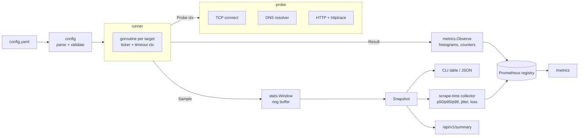

# latprobe

[](https://github.com/uu889/latprobe/actions/workflows/ci.yml)
[](LICENSE)

**latprobe** is a small, multi-target network latency prober written in Go.
It measures **TCP connect**, **DNS resolution** and **HTTP(S)** latency
(with a DNS / connect / TLS / TTFB breakdown) against many targets
concurrently, keeps rolling **p50/p95/p99, jitter and loss** per target, and
exports everything as **Prometheus** metrics.

One static binary, three ways to use it:

| Command | What it does |
|---|---|
| `latprobe probe tcp github.com:443` | Ad-hoc probe of one target, like a smarter `ping` |
| `latprobe run -c config.yaml` | Probe every target N times, print a table or JSON |
| `latprobe serve -c config.yaml` | Probe forever, expose `/metrics` for Prometheus |

## Why

I have spent 14 years running infrastructure for a 24/7 trading platform:
200+ bare-metal servers across 10+ data centers. A big part of that job was
latency: picking data centers and upstreams, catching a resolver or a
transit link that got slower, and proving with numbers where the time went.

The questions were always the same:

- *Is it the network, DNS, TLS or the application?* A single "ping" number
  can't tell you. latprobe splits an HTTPS request into
  `dns → connect → tls → ttfb → transfer`.
- *Is it getting worse at the tail?* Averages hide pain. latprobe tracks
  p95/p99 and jitter, not just the mean.
- *Is it one region or everywhere?* Every target carries a `region` label,
  so dashboards and alerts can be sliced by location.

latprobe is a compact, readable version of the tooling I wish I had on
day one: easy to run from any box, easy to scrape, no agents or databases.

## Features

- **Probes**
  - `tcp`: three-way handshake time. DNS is resolved and timed *separately*,
    so a slow resolver is not reported as network latency.
  - `dns`: query a specific resolver (`1.1.1.1:53`, `8.8.8.8`, your own
    unbound...) directly, A or AAAA.
  - `http`: GET on a **cold connection every time** (fresh transport per
    probe), timing breakdown via `net/http/httptrace`, no redirect
    following, expected status codes.
- **Concurrent scheduling**: one goroutine per target, per-target timeouts,
  context cancellation everywhere.
- **Rolling statistics** over the last N samples: min / avg / p50 / p95 /
  p99 / max, jitter, loss %.
- **Outputs**: aligned CLI table, JSON (`-o json`), Prometheus `/metrics`,
  JSON `/api/v1/summary`, `/healthz`.
- **Operations friendly**: graceful shutdown on SIGINT/SIGTERM, structured
  logs with `log/slog` (text or JSON), strict config validation (unknown
  keys are errors), static binary on a distroless non-root image.
- **Minimal dependencies**: `prometheus/client_golang`, `yaml.v3`, `cobra`.

## Quick start

```bash
# Build (Go 1.26+)
make build            # -> bin/latprobe

# Ad-hoc probes
./bin/latprobe probe tcp github.com:443 -n 10
./bin/latprobe probe dns github.com --resolver 1.1.1.1 -n 10
./bin/latprobe probe http https://www.cloudflare.com/cdn-cgi/trace -n 5

# Probe a whole config once and print a summary
./bin/latprobe run -c examples/config.yaml -n 10 -i 1s
./bin/latprobe run -c examples/config.yaml -o json

# Run as an exporter
./bin/latprobe serve -c examples/config.yaml --listen :9310
curl -s localhost:9310/metrics | grep latprobe_
```

Full stack with Prometheus and a provisioned Grafana dashboard:

```bash
docker compose up -d --build
# latprobe   http://localhost:9310/metrics
# Prometheus http://localhost:9090
# Grafana    http://localhost:3000  (dashboard "latprobe")
```

## Configuration

```yaml
interval: 5s     # time between probes of the same target
timeout: 2s      # default per-probe timeout (must be <= interval)
window: 120      # samples kept per target for percentiles/jitter/loss

targets:
  - name: cloudflare-dns
    type: dns
    address: github.com        # name to resolve
    resolver: 1.1.1.1:53       # server to ask (empty = system resolver)
    record: A                  # A (default) or AAAA
    region: anycast

  - name: github-tcp
    type: tcp
    address: github.com:443
    region: us

  - name: google-204
    type: http
    address: https://www.google.com/generate_204
    expect_status: [204]       # default: any status < 400
    timeout: 4s                # per-target override
    region: anycast
```

See [`examples/config.yaml`](examples/config.yaml) for the full example.
CLI flags `--count/-n`, `--interval/-i`, `--timeout/-t` and
`--output/-o` override the file for one-shot runs.

## Sample output

Real output of `latprobe run -c examples/config.yaml -n 10 -i 1s`:

```text
TARGET            PROBE  REGION   SENT  LOSS    MIN      AVG      P50      P95       P99       MAX       JITTER   LAST
cloudflare-dns    dns    anycast  10    0.0%    0.63ms   1.20ms   1.05ms   1.86ms    2.01ms    2.04ms    0.47ms   198.18.0.1
google-dns        dns    anycast  10    0.0%    0.66ms   1.12ms   0.99ms   1.66ms    1.69ms    1.70ms    0.37ms   198.18.0.1
quad9-dns         dns    anycast  10    100.0%  -        -        -        -         -         -         -        error: lookup github.com: i/o timeout
cloudflare-tcp    tcp    anycast  10    0.0%    0.21ms   0.56ms   0.65ms   0.80ms    0.85ms    0.86ms    0.25ms   1.1.1.1:443
google-tcp        tcp    anycast  10    0.0%    0.29ms   0.60ms   0.67ms   0.84ms    0.84ms    0.84ms    0.21ms   8.8.8.8:443
github-tcp        tcp    us       10    0.0%    0.11ms   0.40ms   0.28ms   0.85ms    0.97ms    1.00ms    0.33ms   198.18.0.1:443
cloudflare-trace  http   anycast  10    0.0%    34.30ms  44.69ms  44.27ms  52.67ms   55.32ms   55.99ms   4.91ms   HTTP/2.0 200 OK
google-204        http   anycast  10    0.0%    51.54ms  60.09ms  61.53ms  64.72ms   65.23ms   65.35ms   3.83ms   HTTP/2.0 204 No Content
github-web        http   us       10    0.0%    60.16ms  94.52ms  80.73ms  153.23ms  155.75ms  156.38ms  33.72ms  HTTP/2.0 200 OK

Phase breakdown (last probe):
  github-tcp        dns=1.95ms  connect=0.25ms
  cloudflare-trace  dns=0.96ms  connect=0.38ms  tls=23.47ms  ttfb=9.21ms  transfer=0.11ms
  google-204        dns=2.05ms  connect=0.44ms  tls=41.24ms  ttfb=21.42ms  transfer=0.08ms
  github-web        dns=2.20ms  connect=0.39ms  tls=92.06ms  ttfb=27.80ms  transfer=26.71ms
```

> **Note on this sample:** it was captured on a sandboxed build machine that
> sits behind a transparent proxy with fake-IP DNS (`198.18.0.0/15`). That is
> why GitHub resolves to `198.18.0.1`, TCP handshakes are sub-millisecond
> (they terminate at the local proxy) and Quad9 is unreachable. The HTTPS
> numbers are end-to-end. On a normal host you will see real RTTs and
> addresses. It also shows how latprobe reports a target with 100% loss.

JSON from `latprobe probe http https://www.cloudflare.com/cdn-cgi/trace -n 3 -o json` (trimmed):

```json
{
  "name": "https://www.cloudflare.com/cdn-cgi/trace",
  "probe": "http",
  "address": "https://www.cloudflare.com/cdn-cgi/trace",
  "sent": 3, "lost": 0, "loss_pct": 0,
  "min_ms": 36.514, "avg_ms": 49.563, "p50_ms": 52.55,
  "p95_ms": 58.919, "p99_ms": 59.485, "max_ms": 59.626, "jitter_ms": 11.556,
  "last": {
    "ok": true, "rtt_ms": 36.514, "detail": "HTTP/2.0 200 OK",
    "phases_ms": {"dns": 1.477, "connect": 0.524, "tls": 24.141, "ttfb": 9.966, "transfer": 0.143}
  }
}
```

## Metrics

All series carry `target`, `region` and `probe` labels.

| Metric | Type | Description |
|---|---|---|
| `latprobe_probe_duration_seconds` | histogram | Latency of successful probes (0.5 ms … 10 s buckets) |
| `latprobe_probe_phase_duration_seconds` | histogram | Per-phase latency, extra `phase` label: `dns`, `connect`, `tls`, `ttfb`, `transfer` |
| `latprobe_probes_total` | counter | Probes executed, extra `result` label: `success` / `failure` |
| `latprobe_probe_success` | gauge | 1 if the last probe succeeded |
| `latprobe_window_latency_seconds` | gauge | Rolling-window percentiles, extra `percentile` label: `p50`, `p95`, `p99` |
| `latprobe_window_jitter_seconds` | gauge | Rolling-window jitter |
| `latprobe_window_loss_ratio` | gauge | Rolling-window loss, 0–1 |
| `latprobe_window_samples` | gauge | Samples currently in the window |
| `latprobe_build_info` | gauge | Always 1, `version` label |

Plus the standard `go_*` and `process_*` collectors.

The histograms are what you should aggregate and alert on, because they can
be summed across instances and re-quantiled over any range:

```promql
# p99 per target over 5 minutes
histogram_quantile(0.99,
  sum by (target, le) (rate(latprobe_probe_duration_seconds_bucket[5m])))

# Where does HTTPS time go? Average per phase
sum by (target, phase) (rate(latprobe_probe_phase_duration_seconds_sum{probe="http"}[5m]))
  / sum by (target, phase) (rate(latprobe_probe_phase_duration_seconds_count{probe="http"}[5m]))

# Failure ratio per region
sum by (region) (rate(latprobe_probes_total{result="failure"}[5m]))
  / sum by (region) (rate(latprobe_probes_total[5m]))
```

The `window_*` gauges are a convenience for quick dashboards and for the
CLI; example alert rules live in
[`deploy/prometheus/alerts.yml`](deploy/prometheus/alerts.yml).

## Architecture



```
cmd/latprobe/        main: version + exit code
internal/config/     YAML loading, defaults, validation
internal/probe/      TCP, DNS, HTTP probers (one measurement per call)
internal/stats/      ring-buffer window, percentiles, jitter, loss
internal/runner/     concurrent scheduling, observers, snapshots
internal/metrics/    Prometheus histograms/counters + window collector
internal/output/     table and JSON rendering
internal/cli/        cobra commands: run, probe, serve, version
deploy/              Prometheus config + alerts, Grafana dashboard
```

Design notes:

- **Probers do one thing.** `Probe(ctx) (Measurement, error)` performs a
  single measurement and honours the context deadline; scheduling, timeouts
  and recording live in the runner.
- **Shutdown is not packet loss.** A probe interrupted by SIGTERM is dropped
  instead of being recorded as a failure.
- **Cold connections for HTTP.** A shared `http.Transport` can hand a
  late-finishing dial from a timed-out probe to the next one, silently
  hiding DNS/connect/TLS from that sample. Each probe builds its own
  transport.
- **Percentiles** use linear interpolation between closest ranks (NumPy's
  default). **Jitter** is the mean absolute difference between consecutive
  successful RTTs (RFC 3550 idea, without smoothing).

## Development

```bash
make test      # go test ./...
make race      # with the race detector
make cover     # coverage summary
make vet lint  # go vet + golangci-lint
```

Tests run fully offline against local servers: a TCP listener, a tiny
UDP DNS responder, and `httptest` HTTP/HTTPS servers.

## Roadmap

- [ ] ICMP echo probe (unprivileged `udp4` ICMP sockets where
      `net.ipv4.ping_group_range` allows it, raw sockets otherwise)
- [ ] TLS certificate expiry and chain info as metrics
- [ ] DNS over TCP / DoT / DoH and per-record-type probes
- [ ] Config hot reload on SIGHUP
- [ ] Multi-location mode: several latprobe agents, one aggregated view
- [ ] Traceroute / MTR-style path snapshot when a target's p99 jumps

## A note on how this was built

Built with AI-assisted tooling (Claude Code); design and review by me.

## License

[MIT](LICENSE) © 2026 Jeff King
